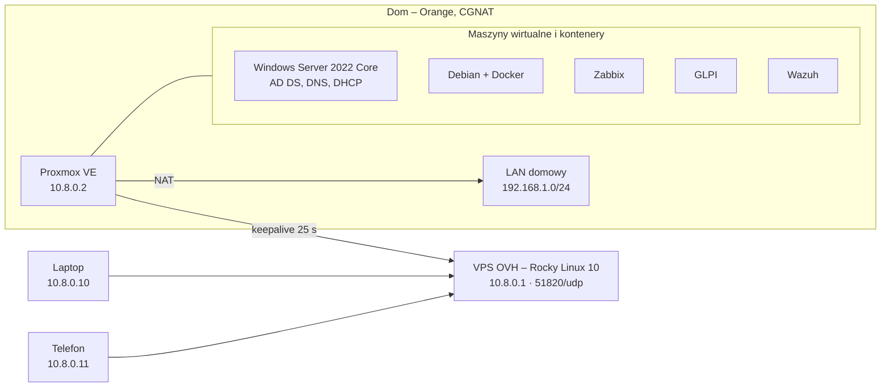

# Homelab – dokumentacja

**Status: w trakcie tworzenia**

## Założenia

Domowe środowisko do eksperymentów, w którym rozwijam umiejętności z zakresu administracji systemami, sieci i bezpieczeństwa. Odtwarzam w nim podstawowe elementy infrastruktury IT: domenę Active Directory, zdalny dostęp przez VPN, monitoring, system helpdesk z ewidencją sprzętu oraz centralną analizę zdarzeń bezpieczeństwa.

Każdy element jest opisany w osobnym folderze: instalacja, konfiguracja, sposób sprawdzenia, że działa.

## Zakres

### Wirtualizacja (Proxmox VE)

- Maszyny wirtualne i kontenery LXC, aplikacje w Dockerze na osobnej maszynie z Debianem
- Kopie zapasowe maszyn na osobny dysk

### Windows Server 2022 Core i Active Directory

- Instalacja w wersji Core, bez interfejsu graficznego
- Konfiguracja i administracja wyłącznie z konsoli i PowerShell
- Kontroler domeny z rolami DNS i DHCP
- Zarządzanie użytkownikami, grupami i jednostkami organizacyjnymi (OU), zasady grupy (GPO)
- Tworzenie skryptów do automatyzacji i zarządzania

### Zdalny dostęp (VPS + WireGuard)

- Łącze domowe jest za CGNAT, więc centrum sieci jest VPS w OVH z Rocky Linux 10
- Proxmox sam zestawia tunel do VPS i podtrzymuje go co 25 sekund, żeby CGNAT go nie zamknął
- NAT na Proxmoxie daje dostęp do całej sieci domowej bez zmian na routerze; nie jest otwarty żaden port
- Laptop i telefon w trybie split tunnel: przez VPN idzie tylko ruch do tunelu i sieci domowej;
- Panele administracyjne (Proxmox, Zabbix, GLPI, Wazuh) są dostępne przez VPN
- Zabezpieczenie VPS:
  - logowanie SSH wyłącznie kluczem, bez konta root
  - firewalld i fail2ban
  - automatyczne instalowanie poprawek bezpieczeństwa

### Monitoring (Zabbix)

- Agenty Zabbix na maszynach z Windows i Linuksem
- Podstawowe alerty: dostępność hostów, zajętość dysków, obciążenie

### Helpdesk i ewidencja sprzętu (GLPI)

- Obsługa zgłoszeń: kategorie, priorytety, przypisywanie do osób
- Ewidencja sprzętu i oprogramowania

### Bezpieczeństwo (Wazuh)

- Agenty Wazuh na kontrolerze domeny i maszynach z Linuksem
- Centralne zbieranie i analiza logów, wykrywanie podejrzanych zdarzeń, np. serii nieudanych logowań
- Monitorowanie integralności plików (FIM) w wybranych katalogach
- Ocena konfiguracji systemów i wykrywanie podatności w zainstalowanym oprogramowaniu

## Architektura

Strzałka wskazuje, kto inicjuje połączenie. Wszystkie urządzenia łączą się wychodząco do VPS, który przekazuje ruch między nimi. Laptop i telefon docierają do sieci domowej przez VPS i tunel Proxmoxa.

### Adresacja tunelu (10.8.0.0/24)

| Urządzenie | Adres w tunelu | Rola |
|---|---|---|
| VPS OVH (Rocky Linux 10) | 10.8.0.1 | centrum sieci, nasłuchuje na 51820/udp |
| Proxmox | 10.8.0.2 | za CGNAT, sam inicjuje połączenie, NAT do sieci domowej |
| Laptop | 10.8.0.10 | klient, split tunnel |
| Telefon | 10.8.0.11 | klient, split tunnel |

Sieć domowa: 192.168.1.0/24. Host ma 8 GB RAM, więc nie wszystkie maszyny działają jednocześnie, uruchamiam je w zależności od tego, co testuję.

### Sprzęt

| Element | Szczegóły |
|---|---|
| Procesor | Intel Core i3-8100 (4 rdzenie) |
| Pamięć | 8 GB DDR4 😭 |
| SSD 256 GB | system, dyski maszyn wirtualnych i kontenerów |
| HDD 1 TB | kopie zapasowe, obrazy ISO |
| Łącze | światłowód Orange: ONT + router Funbox 3 |
| VPS | OVH, Rocky Linux 10 – centrum sieci WireGuard |

