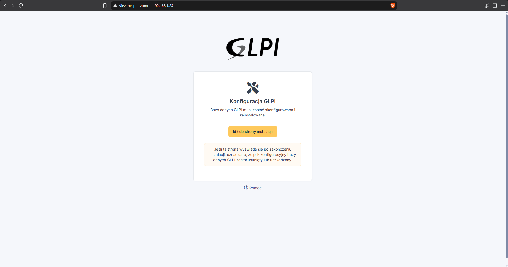
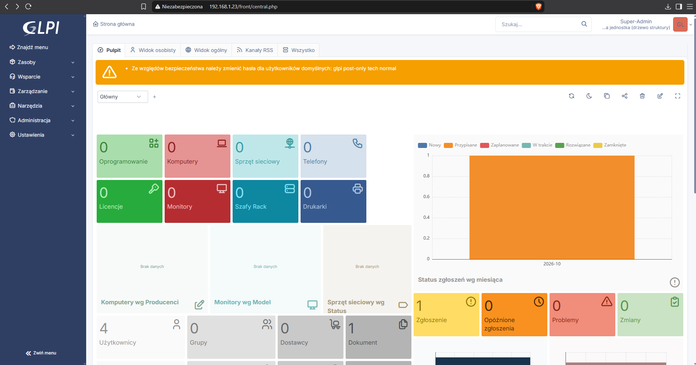

# GLPI

System helpdesk i ewidencja sprzętu. GLPI 12 działa w kontenerze LXC z Debianem 13 na nginx, PHP 8.4 i MariaDB. Panel jest dostępny z sieci domowej i przez VPN.


## 1. Kontener LXC

| Parametr | Wartość |
|---|---|
| Szablon | Debian 13, kontener nieuprzywilejowany |
| CPU / RAM | 1 rdzeń, 1 GB RAM + 512 MB swap |
| Dysk | 10 GB na `local-lvm` |
| Sieć | `vmbr0`, statycznie 192.168.1.xx/24, brama 192.168.1.1 |
| Autostart | wyłączony – kontener uruchamiany w razie potrzeby |

## 2. Instalacja

### Pakiety

```bash
apt update && apt -y upgrade
timedatectl set-timezone Europe/Warsaw
apt install -y nginx mariadb-server cron wget \
  php8.4-fpm php8.4-{curl,gd,intl,mysql,zip,bcmath,mbstring,xml,bz2,ldap}
```

### Baza danych

Do bazy ładowane są też strefy czasowe, z których GLPI korzysta przy datach zgłoszeń:

```bash
mariadb -uroot <<'EOF'
CREATE DATABASE glpi CHARACTER SET utf8mb4 COLLATE utf8mb4_unicode_ci;
CREATE USER glpi@localhost IDENTIFIED BY '<hasło_bazy>';
GRANT ALL PRIVILEGES ON glpi.* TO glpi@localhost;
GRANT SELECT ON mysql.time_zone_name TO glpi@localhost;
EOF

mariadb-tzinfo-to-sql /usr/share/zoneinfo | mariadb -uroot mysql
```

### Pliki GLPI

Kod należy do roota, a serwer WWW może zapisywać tylko w katalogach danych, konfiguracji i wtyczek:

```bash
VER=12.0.0
cd /tmp
wget https://github.com/glpi-project/glpi/releases/download/$VER/glpi-$VER.tgz
tar -xzf glpi-$VER.tgz -C /var/www/
chown -R root:root /var/www/glpi
chown -R www-data:www-data /var/www/glpi/{files,config,marketplace}
```

### nginx

`/etc/nginx/sites-available/glpi` – katalog główny to `public/`, a wszystkie żądania trafiają do `index.php`:

```nginx
server {
    listen 80;
    server_name glpi;
    root /var/www/glpi/public;

    location / {
        try_files $uri /index.php$is_args$args;
    }

    location ~ ^/index\.php$ {
        fastcgi_pass unix:/run/php/php8.4-fpm.sock;
        fastcgi_split_path_info ^(.+\.php)(/.*)$;
        include fastcgi_params;
        fastcgi_param SCRIPT_FILENAME $document_root$fastcgi_script_name;
    }
}
```

```bash
ln -s /etc/nginx/sites-available/glpi /etc/nginx/sites-enabled/
rm /etc/nginx/sites-enabled/default
nginx -t && systemctl reload nginx
```

### PHP

GLPI wymaga, żeby ciasteczko sesji było niedostępne dla JavaScriptu:

```bash
sed -i 's/^session.cookie_httponly =.*/session.cookie_httponly = On/' /etc/php/8.4/fpm/php.ini
systemctl restart php8.4-fpm
```

### Kreator i zabezpieczenie

Kreator pod `http://192.168.1.xx`:
1. Język polski.
2. Sprawdzenie wymagań.
3. Połączenie z bazą: `localhost`, użytkownik `glpi`, baza `glpi`.








