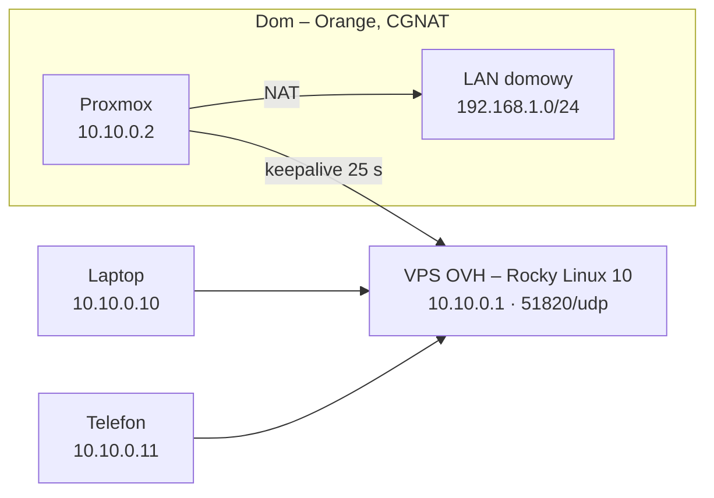

# VPS + WireGuard

Zdalny dostęp do sieci domowej mimo CGNAT. Centrum sieci jest VPS w OVH z Rocky Linux 10. Proxmox za CGNAT-em Orange nie przyjmie połączenia z zewnątrz, więc sam łączy się do VPS i podtrzymuje tunel. Laptop i telefon łączą się do VPS i przez tunel Proxmoxa docierają do całej sieci domowej. Na routerze Orange nie trzeba nic zmieniać ani otwierać.

## Topologia



Strzałka wskazuje, kto inicjuje połączenie.

| Urządzenie | Adres w tunelu | Rola |
|---|---|---|
| VPS OVH (Rocky Linux 10) | 10.10.0.1 | centrum sieci, nasłuchuje na 51820/udp |
| Proxmox | 10.10.0.2 | za CGNAT, sam inicjuje połączenie, NAT do LAN-u |
| Laptop | 10.10.0.10 | klient, split tunnel |
| Telefon | 10.10.0.11 | klient, split tunnel |

Sieć domowa: 192.168.1.0/24, interfejs LAN Proxmoxa: `vmbr0` (sprawdzenie: `ip -br a`).

## 1. Przygotowanie VPS

### Dostęp przez klucz SSH

Na obrazach OVH konto root jest wyłączone; logowanie odbywa się jako `rocky`, a administracja przez `sudo`. Klucz generowany jest na laptopie:

```bash
ssh-keygen -t ed25519 -C "moj-laptop"
ssh-copy-id -i ~/.ssh/id_ed25519.pub rocky@<IP_VPS>
```

Z Windows (PowerShell) klucz wgrywa się jedną komendą. `restorecon` ustawia kontekst SELinux, bez którego Rocky potrafi zignorować klucz:

```powershell
type $env:USERPROFILE\.ssh\id_ed25519.pub | ssh rocky@<IP_VPS> "mkdir -p ~/.ssh && chmod 700 ~/.ssh && cat >> ~/.ssh/authorized_keys && chmod 600 ~/.ssh/authorized_keys && restorecon -R ~/.ssh"
```

Wpis w `~/.ssh/config`, po którym wystarczy `ssh vps`:

```
Host vps
    HostName <IP_VPS>
    User rocky
    IdentityFile ~/.ssh/id_ed25519
```

### Utwardzenie SSH

Pliki w `/etc/ssh/sshd_config.d/` są czytane alfabetycznie i obowiązuje pierwsza napotkana wartość. Prefiks `00-` sprawia, że tych ustawień nie nadpisze np. plik cloud-init włączający logowanie hasłem.

```bash
sudo tee /etc/ssh/sshd_config.d/00-hardening.conf >/dev/null <<'EOF'
PermitRootLogin no
PasswordAuthentication no
KbdInteractiveAuthentication no
PubkeyAuthentication yes
AuthenticationMethods publickey
MaxAuthTries 3
LoginGraceTime 30
X11Forwarding no
AllowUsers rocky
EOF
sudo sshd -t && sudo systemctl reload sshd
sudo sshd -T | grep -Ei 'passwordauth|permitroot'
```

Przed zamknięciem bieżącej sesji trzeba sprawdzić logowanie w drugim terminalu. Hasło użytkownika `rocky` nadal jest wymagane przy `sudo`.

### Aktualizacje

Pełna aktualizacja z restartem, a potem automatyczne instalowanie poprawek bezpieczeństwa:

```bash
sudo dnf -y upgrade && sudo reboot
sudo dnf install -y dnf-automatic
sudo sed -i 's/^upgrade_type.*/upgrade_type = security/; s/^apply_updates.*/apply_updates = yes/' /etc/dnf/automatic.conf
sudo systemctl enable --now dnf-automatic.timer
```

### Firewall, fail2ban, SELinux

```bash
# firewalld: tylko SSH i port WireGuarda
sudo dnf install -y firewalld
sudo systemctl enable --now firewalld
sudo firewall-cmd --permanent --remove-service=cockpit
sudo firewall-cmd --permanent --add-port=51820/udp
sudo firewall-cmd --reload

# EPEL (potrzebny też dla WireGuarda) i fail2ban
sudo dnf config-manager --set-enabled crb
sudo dnf install -y epel-release
sudo dnf install -y fail2ban python3-systemd
sudo tee /etc/fail2ban/jail.local >/dev/null <<'EOF'
[DEFAULT]
bantime = 1h
findtime = 10m
maxretry = 5

[sshd]
enabled = true
backend = systemd
EOF
sudo systemctl enable --now fail2ban
sudo fail2ban-client status sshd
```

Ostrzeżenie `NOT_ENABLED` przy usuwaniu usługi cockpit jest niegroźne. SELinux pozostaje włączony: `getenforce` zwraca `Enforcing`.

## 2. WireGuard na VPS

Moduł WireGuard jest w jądrze Rocky 10, z EPEL instalowane są tylko narzędzia. Polecenia wykonywane są jako root (`sudo -i`):

```bash
dnf install -y wireguard-tools qrencode
mkdir -p /etc/wireguard && cd /etc/wireguard && umask 077
wg genkey | tee vps.key | wg pubkey > vps.pub

echo 'net.ipv4.ip_forward = 1' > /etc/sysctl.d/99-wireguard.conf
sysctl --system

firewall-cmd --permanent --new-zone=vpn
firewall-cmd --permanent --zone=vpn --add-interface=wg0
firewall-cmd --permanent --zone=vpn --add-service=ssh
firewall-cmd --permanent --zone=vpn --add-forward
firewall-cmd --reload

systemctl enable --now wg-quick@wg0
```

Strefa `vpn` wpuszcza SSH z tunelu, a `--add-forward` pozwala przekazywać ruch między peerami, np. z laptopa do domu.

Docelowy `/etc/wireguard/wg0.conf` na VPS:

```ini
[Interface]
Address = 10.10.0.1/24
ListenPort = 51820
PrivateKey = <klucz prywatny VPS>

# Proxmox: za CGNAT, sam inicjuje połączenie (dlatego brak Endpoint)
[Peer]
PublicKey = <klucz publiczny Proxmoxa>
AllowedIPs = 10.10.0.2/32, 192.168.1.0/24

# Laptop
[Peer]
PublicKey = <klucz publiczny laptopa>
AllowedIPs = 10.10.0.10/32

# Telefon
[Peer]
PublicKey = <klucz publiczny telefonu>
AllowedIPs = 10.10.0.11/32
```

Po dopisaniu peera konfigurację przeładowuje się bez zrywania tunelu:

```bash
wg syncconf wg0 <(wg-quick strip wg0)
```

## 3. WireGuard na Proxmoxie

Na Proxmoxie jako root:

```bash
apt update && apt install -y wireguard-tools
mkdir -p /etc/wireguard && cd /etc/wireguard && umask 077
wg genkey | tee proxmox.key | wg pubkey > proxmox.pub
echo 'net.ipv4.ip_forward = 1' > /etc/sysctl.d/99-wireguard.conf
sysctl --system
systemctl enable --now wg-quick@wg0
```

`/etc/wireguard/wg0.conf` na Proxmoxie:

```ini
[Interface]
Address = 10.10.0.2/24
PrivateKey = <klucz prywatny Proxmoxa>
# NAT: urządzenia w LAN widzą ruch z VPN jako ruch od Proxmoxa
PostUp = iptables -t nat -A POSTROUTING -s 10.10.0.0/24 -o vmbr0 -j MASQUERADE
PostDown = iptables -t nat -D POSTROUTING -s 10.10.0.0/24 -o vmbr0 -j MASQUERADE

[Peer]
PublicKey = <klucz publiczny VPS>
Endpoint = <IP_VPS>:51820
AllowedIPs = 10.10.0.0/24
PersistentKeepalive = 25
```

Sprawdzenie na VPS: `wg show` pokazuje przy peerze Proxmoxa `latest handshake`, a `ping -c3 10.10.0.2` odpowiada.

Ważne szczegóły:
- **`AllowedIPs` na Proxmoxie** to tylko `10.10.0.0/24`. Wpis `0.0.0.0/0` puściłby cały ruch internetowy Proxmoxa przez VPS.
- **`AllowedIPs` po stronie VPS** oznacza „ruch do tych adresów wysyłaj do tego peera”, dlatego przy Proxmoxie jest też cały LAN domowy.
- **MASQUERADE** jest potrzebny, bo router Orange nie zna sieci `10.10.0.0/24` i odpowiedzi z urządzeń w LAN nie wróciłyby do tunelu.

## 4. Klienci: laptop i telefon

Oba klienty działają w trybie split tunnel: przez VPN idzie tylko ruch do tunelu i do domu, zwykły internet idzie bezpośrednio.

**Laptop.** W aplikacji WireGuard wybrana opcja „Dodaj pusty tunel”; aplikacja sama generuje klucze. Jej klucz publiczny trafia do `wg0.conf` na VPS.

```ini
[Interface]
PrivateKey = <wygenerowany przez aplikację>
Address = 10.10.0.10/32

[Peer]
PublicKey = <klucz publiczny VPS>
Endpoint = <IP_VPS>:51820
AllowedIPs = 10.10.0.0/24, 192.168.1.0/24
PersistentKeepalive = 25
```

**Telefon** konfigurowany kodem QR. Skrypt na VPS (jako root) generuje klucze, dopisuje telefon jako peera, wyświetla kod QR i usuwa pliki telefonu z serwera:

```bash
cd /etc/wireguard && umask 077
wg genkey | tee phone.key | wg pubkey > phone.pub
cat > phone.conf <<EOF
[Interface]
PrivateKey = $(cat phone.key)
Address = 10.10.0.11/32

[Peer]
PublicKey = $(cat vps.pub)
Endpoint = <IP_VPS>:51820
AllowedIPs = 10.10.0.0/24, 192.168.1.0/24
PersistentKeepalive = 25
EOF
cat >> wg0.conf <<EOF

# Telefon
[Peer]
PublicKey = $(cat phone.pub)
AllowedIPs = 10.10.0.11/32
EOF
wg syncconf wg0 <(wg-quick strip wg0)
qrencode -t ansiutf8 < phone.conf
shred -u phone.key phone.conf
```


