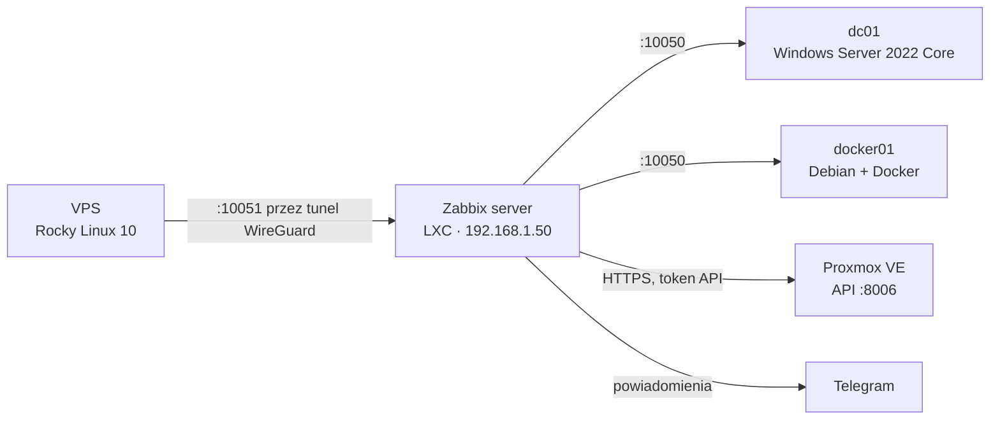

# Zabbix

Monitoring maszyn w homelabie: dostępność hostów, zajętość dysków, obciążenie CPU i pamięci oraz stan usług Windows. Serwer Zabbix 7.0 LTS działa w kontenerze LXC z Debianem 13. Panel jest dostępny z sieci domowej i przez VPN.

## Architektura



Strzałka wskazuje, kto inicjuje połączenie. Maszyny w sieci domowej są odpytywane przez serwer (agent pasywny). VPS sam wysyła dane przez tunel (agent aktywny), więc nie trzeba otwierać na nim żadnego portu.

| Host | Sposób monitorowania | Szablony |
|---|---|---|
| Zabbix server | agent 2, lokalnie | Zabbix server health, Linux by Zabbix agent |
| dc01 | agent 2, pasywny | Windows by Zabbix agent |
| docker01 | agent 2, pasywny | Linux by Zabbix agent, Docker by Zabbix agent 2 |
| pve | HTTP API, token tylko do odczytu | Proxmox VE by HTTP |
| vps | agent 2, aktywny | Linux by Zabbix agent active |

## Decyzje

| Decyzja | Uzasadnienie |
|---|---|
| Zabbix 7.0 LTS | długie wsparcie i oficjalne pakiety dla Debiana 13 i Rocky Linux 10 |
| Kontener LXC zamiast VM | pojedyncza usługa, kilkukrotnie mniejszy narzut pamięci przy 8 GB RAM hosta |
| MariaDB + nginx | standardowy, lekki zestaw z oficjalnej instrukcji Zabbixa |
| Agent aktywny na VPS | dane płyną tunelem z VPS do serwera; bez otwierania portu 10050 i bez tras w sieci domowej |


## 1. Kontener LXC

| Parametr | Wartość |
|---|---|
| Szablon | Debian 13, kontener nieuprzywilejowany |
| CPU / RAM | 2 rdzenie, 1 GB RAM + 512 MB swap |
| Dysk | 16 GB na `local-lvm` |
| Sieć | `vmbr0`, statycznie 192.168.1.50/24, brama 192.168.1.1 |
| Autostart | wyłączony – kontener uruchamiany w razie potrzeby |

Po uruchomieniu kontenera:

```bash
apt update && apt -y upgrade
timedatectl set-timezone Europe/Warsaw
```

## 2. Serwer Zabbix

Repozytorium Zabbixa i pakiety:

```bash
apt install -y wget
wget https://repo.zabbix.com/zabbix/7.0/debian/pool/main/z/zabbix-release/zabbix-release_latest_7.0+debian13_all.deb
dpkg -i zabbix-release_latest_7.0+debian13_all.deb
apt update
apt install -y zabbix-server-mysql zabbix-frontend-php zabbix-nginx-conf zabbix-sql-scripts zabbix-agent2 mariadb-server
```

Baza danych. Debian 13 ma MariaDB 11.8, w której klientem jest polecenie `mariadb` (stare `mysql` nie zawsze jest dostępne). Root loguje się do bazy przez gniazdo systemowe, więc jego hasło nie jest potrzebne. Kodowanie `utf8mb4_bin` jest podane wprost, bo domyślne w MariaDB 11.8 nie pasuje do Zabbixa.

```bash
mariadb -uroot <<'EOF'
CREATE DATABASE zabbix CHARACTER SET utf8mb4 COLLATE utf8mb4_bin;
CREATE USER zabbix@localhost IDENTIFIED BY '<hasło_bazy>';
GRANT ALL PRIVILEGES ON zabbix.* TO zabbix@localhost;
SET GLOBAL log_bin_trust_function_creators = 1;
EOF

zcat /usr/share/zabbix-sql-scripts/mysql/server.sql.gz | mariadb --default-character-set=utf8mb4 -uzabbix -p zabbix

mariadb -uroot -e "SET GLOBAL log_bin_trust_function_creators = 0;"
```

Konfiguracja. W `/etc/zabbix/zabbix_server.conf`:

```
DBPassword=<hasło_bazy>
```

W `/etc/zabbix/nginx.conf` odkomentowane i ustawione:

```
listen          8080;
server_name     zabbix;
```

Uruchomienie usług:

```bash
systemctl restart zabbix-server zabbix-agent2 nginx php8.4-fpm
systemctl enable zabbix-server zabbix-agent2 nginx php8.4-fpm
```


Kreator pod `http://192.168.1.50:8080`: hasło bazy, nazwa serwera `homelab`, strefa czasowa Europe/Warsaw. Domyślne konto `Admin` / `zabbix` – hasło zmienione od razu po pierwszym logowaniu.


## 3. Agenty

### Windows Server 2022 Core (dc01)

Instalacja z PowerShella. Aktualna wersja agenta jest na stronie zabbix.com/download_agents:

```powershell
$ver = "7.0.x"
$msi = "zabbix_agent2-$ver-windows-amd64-openssl.msi"
New-Item -ItemType Directory C:\Temp -Force | Out-Null
Invoke-WebRequest "https://cdn.zabbix.com/zabbix/binaries/stable/7.0/$ver/$msi" -OutFile "C:\Temp\$msi" -UseBasicParsing

Start-Process msiexec -Wait -ArgumentList "/i C:\Temp\$msi /qn SERVER=192.168.1.50 SERVERACTIVE=192.168.1.50 HOSTNAME=dc01"

New-NetFirewallRule -DisplayName "Zabbix Agent 2" -Direction Inbound -Protocol TCP -LocalPort 10050 -RemoteAddress 192.168.1.50 -Action Allow
Get-Service "Zabbix Agent 2"
```

Reguła zapory przepuszcza połączenia tylko z serwera Zabbix. Szablon Windows sam wykrywa usługi z automatycznym startem, więc zatrzymanie np. usług AD DS lub DNS wywołuje alert.

### Debian z Dockerem (docker01)

Repozytorium jak na serwerze (pakiet `zabbix-release` dla danej wersji Debiana), potem:

```bash
apt install -y zabbix-agent2
```

W `/etc/zabbix/zabbix_agent2.conf`:

```
Server=192.168.1.50
ServerActive=192.168.1.50
Hostname=docker01
```

Szablon Docker odczytuje dane z gniazda Dockera, więc użytkownik agenta musi być w grupie `docker`:

```bash
usermod -aG docker zabbix
systemctl restart zabbix-agent2 && systemctl enable zabbix-agent2
```

### VPS (Rocky Linux 10) – agent aktywny

Na VPS jest włączony EPEL, więc najpierw wykluczone są jego pakiety Zabbixa, żeby nie mieszały się z oficjalnymi. W `/etc/yum.repos.d/epel.repo`, w sekcji `[epel]`, dopisane:

```
excludepkgs=zabbix*
```

Instalacja:

```bash
sudo dnf install -y https://repo.zabbix.com/zabbix/7.0/rhel/10/x86_64/zabbix-release-latest-7.0.el10.noarch.rpm
sudo dnf install -y zabbix-agent2
```

W `/etc/zabbix/zabbix_agent2.conf`:

```
Server=127.0.0.1
ServerActive=192.168.1.50
Hostname=vps
```

```bash
sudo systemctl enable --now zabbix-agent2
```

`Server=127.0.0.1` wyłącza zdalne odpytywanie agenta. VPS sam łączy się z serwerem przez tunel WireGuard, a NAT na Proxmoxie dostarcza ruch do kontenera. W Zabbixie host `vps` ma tylko szablon „Linux by Zabbix agent active”, bez interfejsu.


## 4. Alerty i powiadomienia
...

## 5. Testy
...
